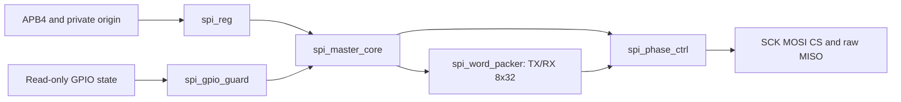
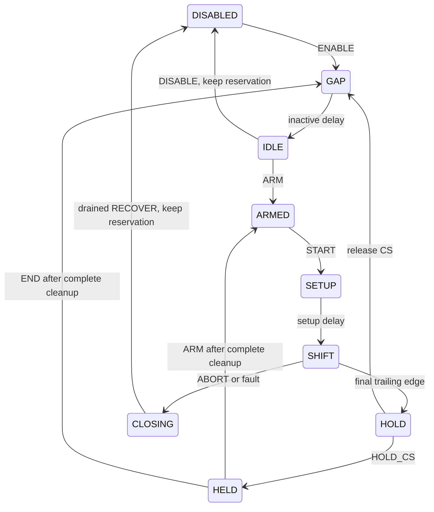

# SPI-P1 Standalone Core

This implementation follows [SPI APB 1.0](spi.md) from
`dev@e62ccdad87e1fd412eff70cc2527ad3090f16a55`. It is a standalone block;
Tiny and Mini product filelists, address/IRQ/RCU routing, GPIO, DMA and SDK
runtime interfaces are unchanged. DMA capability is zero. Qualification and
phase acceptance belong to the [ledger](spi-verification.md).

The 2026-10-19 review-closure change affects test/evidence sources only. It
adds independent PCLK-counted waveform checks, complete-core FIFO pressure
cases and tool-input schema 2. Production RTL, profiles, ABI and dependencies
remain byte-identical to the reviewed implementation. The final campaign uses
`BUILD_TIMESTAMP=2026-10-19-07-00`; all planned gates passed below the new
ICS55/IHP130 variants, including one full Pytest run (2085 passed, one optional
PDF-test skip). The ledger records the measured results and remaining gates.

## Structure and interfaces



All state uses PCLK and Common registers. The two Common FIFOs have explicit
pre-edge push/pop qualification: full plus pop does not authorize a push.
Payload arrays are not reset; validity and packing state hide stale data.
The APB response is registered, and each access performs its side effect once.
Full/empty FIFO and invalid source accesses error without waiting for SCK.

The private origin encoding is CPU=0, central DMA=1, other=2/3. Request and
channel qualification, per-direction reserved credit, credit retirement,
complete job/response status and pending START are external integration inputs.
They must remain attached to the admitted request. A credit commit is a FIFO
event, not terminal AXI retirement. The wrapper rejects reuse until retirement.
P1 test environments provide those inputs; no DMA allocator, TCD lifecycle,
fabric origin capture or CDC path is implemented here. PPROT is not an origin.

The GPIO guard receives USER_SELECT, handoff, ALT selection, software OE,
open-drain and readiness. It checks prospective and retained session pins,
permits mutable D/C level, and disables only SPI's own OE on route loss.
Actual GPIO/RCU gating veto and software handback are P3 obligations.



ABORT applies to every acquired state, not only SHIFT. It does not count a
partial frame or report successful completion. Emergency guard loss permits
truncation; RECOVER disables monitoring before DISABLED handback even if the
external guard remains invalid. RELEASE alone relinquishes the reservation.
Wire completion and pending RX/transport cleanup remain separate conditions.

## Validation entrypoints

Activate `.cache/retrosoc/development/tiny-r2-p1/activate.sh`, choose one fresh
`BUILD_TIMESTAMP` and an explicit Tiny profile/PDK. The new targets are
`spi-p1-lint`, `spi-p1-rtl`, `spi-p1-formal`, `spi-p1-synth`,
`spi-p1-netsim`, `spi-p1-sta` and `spi-p1-report`.
`SIMU=VERILATOR` or `SIMU=IVERILOG` selects standalone behavioral execution.
Both backends use balanced mapping and PCLK SAFE24. Existing attempt roots
are never overwritten. A changed source requires a new timestamp.

For example, after approval:

```sh
make CONFIG=configs/ci/ics55-tiny.mk SOC=TINY PDK=ICS55 HAVE_SVA=YES \
  JOBS=4 spi-p1-lint spi-p1-rtl
```

All simulation commands require zero exit, exactly one fixture-specific
`SPI_P1_PASS` marker and no forbidden failure marker. The independent pin
model observes SCK/CS/MOSI and supplies deterministic MISO data without
accessing DUT internals. Unit markers do not replace Tiny TEST_STATUS for
future integrated firmware. The full product's long Icarus regression remains
deferred under the existing maintainer decision; P10 remains pending closure.

The pin oracle counts half-periods in PCLK cycles, checks CPHA=0 first-bit
setup, complete final trailing edges and CS setup/hold/inactive intervals,
and permits stretching only between complete frames at CPOL. Normal ABORT
does not disable the checker: only the remaining trailing edge is allowed.
The synthetic checker fixture includes 16 valid mode/width/order cases, one
valid partial-frame abort, and eleven rejected traces (short/long half-period,
setup, frame termination, hold/inactive, post-abort edge, pause polarity and
payload errors). Each rejected trace must produce exactly its expected fault
mask. DUT fixtures fail on any nonzero mask; no general failure-marker waiver
is introduced for expected-negative tests.

Results and immutable attempts are below the selected variant's
`meta/spi-p1/<stage>/`, including sources, model/netlist, tools' logs and JSON
results. The original campaign completed on 2026-10-19 with 2068 passed /
1 optional PDF-test skip. That historical result predates the review fixes;
the ledger separates it from the new campaign.
Human phase acceptance remains pending. No qualified frequency, PDF
publication, commit or push is implied.

The block SDC defines only PCLK. MISO/serial Pad/board round-trip timing is
uncharacterized; no blanket reset or MISO false path suppresses that gap.
Negative setup/hold and unconstrained boundaries remain observational records,
not a completed product timing analysis. Final combined qualification must
use the actual SPI/PIO-lite/PPALite-inclusive Tiny design.

## Coverage and formal boundaries

The core fixture exercises all 48 mode/width/order/direction combinations,
DIV=65535, and 256 additional segments using seed `0x53504931`, including
non-default RX-only dummy values. Pin decoding is independent of the DUT.
The APB fixture covers the frozen constant map, invalid accesses, 64-bit
round-up rejection in both widths, maximum legal quotas, full/empty FIFO,
watermark versus sticky IRQ behavior and source-qualified credit retirement.
The lifecycle fixture checks ABORT in all eight acquired states, additional
mid-frame abort offsets, held-CS width changes, maximum CS delays, asynchronous
reset, retained ownership and persistent GPIO faults during closing/recovery.
The packer fixture checks pre-edge full/empty behavior, including simultaneous
push/pop. The mapped-netlist fixture repeats the 48 pin cases and focused
APB rejection/abort/recover/release checks with actual standard-cell models.

Both RTL simulators and both mapped netlists now execute 48 complete-core
pressure cases: modes0..3 x widths8/16 x both orders x three directions.
Counts37/19 require ten words and include a partial final transport word.
TX service starts with one word, deliberately waits at the next word boundary,
then replenishes the remaining words. RX service is withheld until eight
words fill the FIFO, then interleaved with deterministic 23..25-cycle delays.
Each observed wait is held for at least31 PCLKs; pins/edge count remain stable
at CPOL with CS active, and the corresponding stall counter must advance.
The pin and packed-data oracles check all resumed frames, quotas and tails.
Sixteen additional cases abort under TX starvation or RX-full pressure, and
112 cases sweep14 abort offsets at DIV7 across all modes and widths. Abort
checks retain the frozen `2*DIV + CS_HOLD + CS_INACTIVE + 2` bound and verify
event/frame accounting and retained session ownership after recovery.

Output enable is independent of retained session ownership. ABORT from a
disabled-but-owned session cannot re-enable pins. A guard loss latches the
clamp until explicit recovery; restoring routing does not restore SPI OE.
Reserved or consumed credits remain transport-busy until retirement, and
registered FIFO responses remain pending through APB completion. The current
CPU control access is excluded from the transport-idle predicate.

Formal evidence is compositional. The phase engine and register shell have
separate 32-step induction tasks. The session-core BMC retains the 192-step
bound, symbolic commands, legal register-update boundaries, independent
transport/readiness/fault inputs and accepted FIFO service. It uses DIV1..4,
CS delays1..3 and frame counts0..5; full numerical boundary cases are directed
simulations. It does not model DMA V2.2 allocation, descriptor execution,
Tiny source capture, CDC or physical MISO timing.
The independent phase-engine proof also limits DIV to 1..4; DIV65535 is
checked by both directed simulators, not claimed as an exhaustive formal range.

The 320-step cover task must reach serial activity, completion and closing,
and produce a witness spanning the complete 192-cycle BMC window. The BMC
uses `--nopresat`: this explicit long witness checks satisfiable assumptions
without repeating that query before every assertion query. Conversion uses
`sv2v -E Assert`; model-level assertion/cover counts and witness length are
checked, so a successful empty proof cannot qualify. Full arbitrary-APB
monolithic BMC experiments that timed out remain separate historical attempts,
not complete-system proofs or waived current checks.

The BMC task has a 1200-second execution allowance: the original 600-second
attempts reached approximately step178 without a counterexample and timed out.
The bound remains 192 and all properties remain enabled. Induction and cover
tasks retain 600 seconds. This execution-budget adjustment does not change
the frozen hardware contract, proof assumptions or global quality policy.

The deep cover disables optional VCD export (`vcd off`) and retains the
Yosys witness, SMT constraints and Verilog testbench. The 23:25 cover reached
all goals, including step194, but timed out exporting its VCD; that attempt
is not a passed cover. `SPI_P1_FORMAL_REUSE_ROOT` can identify an earlier
formal stage for reuse of successful induction/BMC subtasks only. Reuse
requires identical regenerated and actually consumed models, equivalent SBY
configuration (only the model path is normalized), unchanged proof inputs
and tools, intact original artifacts, a successful command/status and active
properties. Original producer identities, commands and timestamps are retained.
Failure of any check stops reuse; the cover task always executes afresh.

Tool-input schema2 additionally hashes actual `yosys-smtbmc`/`yosys-abc`,
the installed Yosys bin/data tree, SBY Python modules, SMT/witness helpers and
the Python interpreter/venv configuration. Missing components, mixed Yosys
installations and script-directory module shadowing fail closed. Formal
invocations select absolute SBY/Yosys/SMTBMC/ABC paths and clear user
PYTHONPATH/site overrides. Python bytecode caches are not proof inputs.
Revalidation compares the full inventory as well as individual hashes, so
added/removed files cannot evade detection. Original schema-less records
remain historical and cannot be reused under the stronger rule. The new
campaign therefore executes one fresh induction/BMC/cover sequence, shared
only as cell-free evidence by the IHP130 report.

For the original recorded campaign, use `BUILD_TIMESTAMP=2026-10-18-23-58`,
`HAVE_SVA=YES` and `JOBS=4` with explicit TINY/PDK selection. The common logic
evidence is under the ICS55 variant. IHP130 report assembly supplies
`SPI_P1_COMMON_ROOT=build/ics55-tiny-2026-10-18-23-58-bbe722dc382e`; only
cell-free RTL/formal evidence is shared. Each PDK has its own synthesized
netlist, mapped simulation, Liberty inputs and STA reports.

The exact invocation records and quality/JUnit results are retained under
the ICS55 variant's `meta/spi-p1/validation/`. Product firmware compilation
is compatibility evidence only; the SPI core is absent from product filelists.
The firmware, protocol and evidence-tool checks run before one full Pytest
execution. Repeated successful P7/VGA full-system simulations are not part
of this campaign.

Original standalone commands (historical; these roots must not be overwritten):

```sh
source .cache/retrosoc/development/tiny-r2-p1/activate.sh
make CONFIG=configs/ci/ics55-tiny.mk SOC=TINY PDK=ICS55 HAVE_SVA=YES \
  SIMU=VERILATOR SYNTH=YOSYS STA=OPENSTA JOBS=4 BUILD_TIMESTAMP=2026-10-18-23-58 \
  SPI_P1_FORMAL_REUSE_ROOT=build/ics55-tiny-2026-10-18-23-25-bbe722dc382e/meta/spi-p1/formal \
  spi-p1-lint spi-p1-rtl spi-p1-formal spi-p1-synth spi-p1-netsim spi-p1-sta
make CONFIG=configs/ci/ics55-tiny.mk SOC=TINY PDK=ICS55 HAVE_SVA=YES \
  SIMU=IVERILOG SYNTH=YOSYS STA=OPENSTA JOBS=4 BUILD_TIMESTAMP=2026-10-18-23-58 spi-p1-rtl
make CONFIG=configs/ci/ihp130-tiny.mk SOC=TINY PDK=IHP130 HAVE_SVA=YES \
  SIMU=IVERILOG SYNTH=YOSYS STA=OPENSTA JOBS=4 BUILD_TIMESTAMP=2026-10-18-23-58 \
  spi-p1-synth spi-p1-netsim spi-p1-sta
make CONFIG=configs/ci/ics55-tiny.mk SOC=TINY PDK=ICS55 HAVE_SVA=YES \
  SIMU=VERILATOR SYNTH=YOSYS STA=OPENSTA JOBS=4 BUILD_TIMESTAMP=2026-10-18-23-58 spi-p1-report
make CONFIG=configs/ci/ihp130-tiny.mk SOC=TINY PDK=IHP130 HAVE_SVA=YES \
  SIMU=IVERILOG SYNTH=YOSYS STA=OPENSTA JOBS=4 BUILD_TIMESTAMP=2026-10-18-23-58 \
  SPI_P1_COMMON_ROOT=build/ics55-tiny-2026-10-18-23-58-bbe722dc382e spi-p1-report
```

Compatibility firmware builds used `BUILD_TIMESTAMP=2026-10-18-23-25`,
`JOBS=4`, explicit `SOC`/`PDK` and `firmware`, respectively with
`configs/ci/ics55-tiny.mk` (TINY/ICS55), `configs/ci/ihp130-tiny.mk`
(TINY/IHP130), and `configs/ci/ihp130.mk` (MINI/IHP130). Their original
commands, source snapshots and results remain in the 23:25 ICS55 SPI
`validation/` directory; later changes affect standalone orchestration and
tests, not firmware inputs. No firmware simulation is claimed.

Quality commands include `make CONFIG=configs/ci/ics55-tiny.mk SOC=TINY
PDK=ICS55 JOBS=4 format-check rtl-style-check-all rtl-readiness-check-all
sw-policy-check sw-host-test`, `ruff check .`, a standalone C11 header
compile, `git diff --check`, and PR/nightly dry-runs with explicit
TINY/ICS55, TINY/IHP130 and MINI/IHP130 selectors. Full Pytest uses
`python3 -m pytest -q --basetemp <validation>/pytest-all-tests
--junitxml <validation>/pytest-all.xml`; exact expanded commands and results
are retained under `validation/`. No new MISRA deviation is required for the
constant-only header; automated checks are not complete MISRA certification.

The full Pytest run held all Git-owned source bytes stable. The final ledger
and this runbook were updated afterward to record the result; that documentation
delta is separate from the immutable test snapshot. Parallel Make invocations
can refresh the parent variant manifest's simulator selector. Per-stage
command/result logs and fixture names identify the simulator actually executed;
the parent manifest supplies the unchanged hardware profile, not a substitute
for those execution records.

For the review-closure campaign, keep the same explicit profile/PDK,
`HAVE_SVA=YES`, simulator/backend and job selections, replace the timestamp
with `2026-10-19-07-00`, and leave `SPI_P1_FORMAL_REUSE_ROOT` empty.
IHP130 report assembly uses
`SPI_P1_COMMON_ROOT=build/ics55-tiny-2026-10-19-07-00-bbe722dc382e`.
Run the pure tool/parity tests and checker selftest first, then quality checks,
the two RTL simulators, fresh formal and separate block backends. Run one full
Pytest after these pass; retain exact commands and source snapshots in the
new ICS55 variant's `meta/spi-p1/validation/`. Firmware inputs did not change,
so existing firmware results retain their original producer identity.

The retained campaign driver is
`build/ics55-tiny-2026-10-19-07-00-bbe722dc382e/meta/spi-p1/validation/run.py`.
It records exact expanded commands and source maps for `quick`, `rtl`,
`formal`, `backend-ics55`, `backend-ihp130`, `report` and `full`; completed
attempts reject overwriting. `audit.py` verifies the current-source records,
both PDK artifacts, all fixture case counts, fresh formal provenance and the
eight-file repair boundary. `docs-audit.json` records the two documentation
updates after full Pytest. These files are generated campaign evidence, not
project documentation or a new product build interface.
